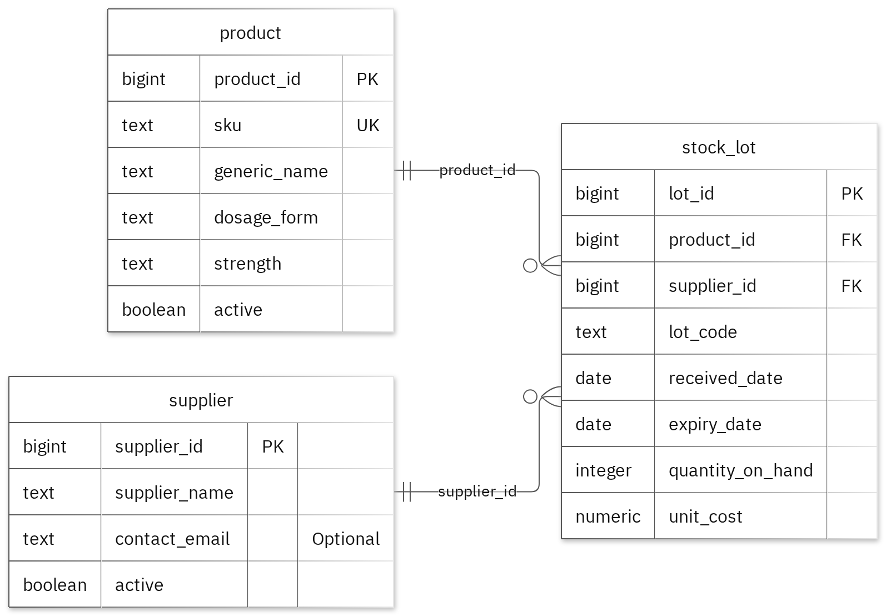

# MIT 8103 Advanced Database Systems

**Pharmacy / Drug Inventory System** · Ifechukwude Obi · Student ID 301924392

## Case study

This case study presents a database architecture tailored for pharmacy inventory personnel, procurement staff, and database management students. The system centers on three primary relational tables: product, supplier, and stock_lot.

Core Workflows & Operational Capabilities
Lot Receipt Recording: Captures incoming inventory batches, tracking associated product information, supplier details, manufacture and delivery dates, received quantities, and unit costs.
Expiry Tracking: Monitors active inventory batches nearing expiration to link each lot to its respective product.
Stock Summarization: Aggregates overall in-stock quantities per product across all active lots.

## Portfolio 1: Database Design and Modelling

The relational database design consists of three main tables. Primary keys uniquely identify each record, while foreign keys preserve relationships between entities. Business rules are enforced through check constraints; for instance, the quantity on hand cannot be negative. Normalization examples demonstrate sample data across 1NF, 2NF, and 3NF. Additionally, all 27 deliberately invalid insert attempts were successfully rejected, keeping the valid sample rows intact.

Figure 1. Tables, keys, and relationships. PK: primary key; FK: foreign key; UK: unique value.

<!-- PAGE BREAK -->

## Portfolio 2: Query Processing and Optimization

Three SQL queries were executed on the sample dataset. A join operation yielded two records, pairing AMX-26-A with RX-1001. To evaluate index performance, a separate set of 20,000 rows was analyzed. Implementation of the new index reduced median lookup latency from 0.952 ms to 0.205 ms, as confirmed by the updated query execution plan. Result sets remained identical across both evaluation phases. Note that these performance metrics are specific to the tested workload and environment.
 lookup and environment.

## Portfolio 3: Transactions and Concurrency

To evaluate COMMIT, ROLLBACK, and READ COMMITTED isolation, a temporary counter was added to stock_lot. Uncommitted changes were kept invisible to separate sessions, and executing a ROLLBACK successfully reverted the data to its previous committed state. Under standard execution without locking, concurrent updates caused lost updates, leaving the counter at 2. Applying SELECT FOR UPDATE ensured Session B paused until Session A finished, correctly yielding a final count of 3. This test column was used exclusively for this evaluation and does not affect the core business fields.

## Portfolio 4: NoSQL and Advanced Data Models

The inventory_events collection stored event documents for this case study. Four sample events were inserted into MongoDB, and all four test queries executed successfully with expected results. Schema validation effectively enforced data integrity by rejecting an invalid date type and a duplicate event ID.
Using embedded snapshots keeps related details consolidated within each event, while the flexible details field accommodates distinct schemas per event type. Note that these are fictional test events, and PostgreSQL remains the primary system enforcing relational rules.

## Repository and evidence

https://github.com/Athan-Obi/Obi_Ifechukwude_301924392

The portfolio folders contain the SQL and JavaScript, explanations, query plans, result tables, and screenshots.

<!-- PAGE BREAK -->

## Portfolio 5: Distributed and Cloud Database Exercise

Deploying three MongoDB replica members across separate failure zones. The discussion focuses on primary elections, majority acknowledgments, secondary replication lag, and sharding trade-offs for inventory_events. While replication ensures high availability, backups remain necessary for disaster recovery. Note that PostgreSQL requires a separate availability plan, and this proposal covers architectural discussion only—no live replica set or failover tests were deployed.

## Individual reflection

Product, supplier, and stock_lot details were separated into distinct tables to maintain data integrity and eliminate redundancy across related records. Quantity on hand is constrained to non-negative values, which constraint tests verify along with required fields and foreign key links. The two-session exercise highlights a classic concurrency issue: both sessions can read the same initial value before either update commits. Explicitly locking the row before reading ensures both increments are preserved. Finally, the index comparison demonstrates the importance of analyzing execution plans alongside query results, as identical outputs can vary significantly in database workload.

## AI-use declaration

alongside a portfolio generator to help develop the database model, write scripts, and draft explanations. The generator executed the PostgreSQL and MongoDB exercises, verified the output, and captured the result images. I retain full responsibility for reviewing and explaining all submitted work.

## References

- [PostgreSQL: constraints](https://www.postgresql.org/docs/17/ddl-constraints.html)
- [PostgreSQL: EXPLAIN](https://www.postgresql.org/docs/17/using-explain.html)
- [PostgreSQL: isolation](https://www.postgresql.org/docs/17/transaction-iso.html)
- [PostgreSQL: row locks](https://www.postgresql.org/docs/17/explicit-locking.html)
- [MongoDB: data modeling](https://www.mongodb.com/docs/manual/data-modeling/)
- [MongoDB: replication](https://www.mongodb.com/docs/manual/replication/)
- [MongoDB: sharding](https://www.mongodb.com/docs/manual/sharding/)
- [Mermaid: ER diagrams](https://mermaid.js.org/syntax/entityRelationshipDiagram.html)

